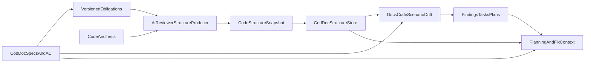

---
# workspace draft — richer-providers still pending; do not treat as merged RFC
todos:
  - id: protocol
    status: completed
    content: 'Зафиксировать structure/obligations schemas, общий EvidenceProvider receipt, identity/temporal/trust semantics и contract fixtures'
  - id: identity-trust
    status: completed
    content: 'Реализовать observed identity, lineage events, branch/run alignment, ingest trust tiers и payload limits'
  - id: producer
    status: completed
    content: 'Реализовать layered producer и SCIP pilot для TS/JS: boundaries, entities, contracts, dependencies, tests, LCOV и assessments'
  - id: consumer
    status: completed
    content: 'Реализовать в cod-doc blob-first идемпотентный ingest, scoped normalization и structure queries'
  - id: obligations-drift
    status: completed
    content: 'Добавить cod-doc obligations export, связи docs↔contracts и deterministic structure/doc/scenario drift'
  - id: scenario-evidence
    status: completed
    content: Подключить mutation testing critical contracts и property generation из cod-doc obligations
  - id: platform-context
    status: completed
    content: Добавить structure_context MCP с обязательным pinned SHA и адресным контекстом для планов/исправлений
  - id: workflows
    status: completed
    content: 'Добавить bootstrap, link suggestions, triage, waiver/baseline и fix-verify lifecycle'
  - id: verify
    status: completed
    content: 'Проверить cross-repo contract, evidence ceilings, idempotency, drift lifecycle и end-to-end platform flow'
  - id: richer-providers
    content: 'После базового контура: compiler/AST provider, per-test execution, exact ranges/signatures и PR slice'
    status: pending
name: Structure platform integration
overview: 'Создать общий доказательный контур ai-reviewer + cod-doc: послойно извлекать границы, сущности, контракты, зависимости, тесты и coverage; сопоставлять их с документированными обязательствами; хранить versioned snapshots, выявлять drift и выдавать точный контекст для планирования, исправления и расширения контрактов.'
isProject: true
---

# Единый контур структуры, контрактов и тестовых сценариев

## Цель

Построить общий сервисный контур между **ai-reviewer** и **cod-doc**, который:

1. наблюдает фактическую структуру кода и тестов;
2. знает документированные контракты, ограничения и acceptance criteria;
3. сопоставляет код, документацию и тестовые evidence;
4. отличает фактическое покрытие кода от покрытия сценариев;
5. выявляет непроверенные крайние случаи, расхождения code↔docs и точки высокого dependency-риска;
6. выдаёт не общий Markdown, а адресный контекст для создания плана, точного исправления или расширения контракта.

North star:

> Для любого boundary, контракта или задачи платформа может показать: где это реализовано, кто зависит от контракта, какие обязательства зафиксированы в документации, какие тестовые сценарии подтверждены, каких evidence не хватает и что именно следует изменить.

## Ответственность инструментов

- **ai-reviewer / structure producer** владеет наблюдаемыми фактами о коде, тестах, зависимостях и coverage. Он не меняет документацию и не объявляет намерения проекта.
- **cod-doc** владеет документированными обязательствами, ADR, module specs, stories, plans и tasks. Он хранит structure snapshots, связывает их с документацией и считает drift.
- **Общий протокол** является границей сервиса. JSON — канонический machine artifact; Markdown — только человекочитаемая проекция.
- PR merge-gate остаётся отдельным контуром. Structure/scenario gaps не блокируют merge автоматически.

Протокол разделён на три independently-versioned документа:

- `obligations_export.v1` — cod-doc → analyzer; документированные claims/acceptance criteria;
- `structure_facts.v1` — ai-reviewer → cod-doc; факты для конкретного code snapshot;
- `structure_assessment.v1` — результаты сопоставления facts + obligations + test run + thresholds.

Так docs-only изменение создаёт новый assessment, но не копирует и не перестраивает code facts. Schema каждого документа имеет `$id`, `schemaRef`, major compatibility policy и canonical cross-repo fixture. Additive fields игнорируются старым consumer; удаление/изменение required fields требует новой major version.

## Сквозной поток




Двусторонний цикл:

1. cod-doc экспортирует структурированные obligations с `contentHash` и code references;
2. ai-reviewer анализирует код/тесты с учётом obligations;
3. cod-doc принимает snapshot, нормализует его и сравнивает с текущими docs;
4. drift/hints превращаются в findings и при необходимости в tasks/plans;
5. task context возвращает агенту только релевантный structure slice.

## Послойный анализ

Использовать двухпроходную схему, а не жёсткий waterfall:

1. **Discovery** — языки, manifests/workspaces, source/test/generated roots, path aliases.
2. **Provisional boundaries** — package/service/layer/module по manifests, профилю и путям.
3. **Entities** — files, functions, inferred classes/interfaces/types, methods, test cases.
4. **Observed contracts** — exports/re-exports, inherits/implements, entrypoints и доступные signatures/errors.
5. **Dependencies** — contains/method/imports/calls/inherits/implements.
6. **Boundary refinement** — уточнение по dependency graph/communities без изменения stable entity ids.
7. **Coverage observations** — LCOV files/functions и, когда доступно, per-test execution.
8. **Scenario assessment** — obligations ↔ contracts ↔ tests ↔ runtime evidence.
9. **Metrics/hints** — только после проверки freshness и data quality.

Промежуточные слои кэшируются:

- structure facts: `headSha + providerVersion + structureConfigHash`;
- obligations: `project + docsRevision/contentHashes`;
- coverage: `testRunId + coverageHash`;
- assessments: hashes трёх предыдущих входов + thresholds.

Новый LCOV не перестраивает entities/dependencies; изменение docs не переобходит код; изменение thresholds не пересчитывает facts.

## Идентичность и временная согласованность

Произвольный rename невозможно надёжно распознать одним hash. Поэтому различать:

- `observedId` — детерминированный id сущности внутри snapshot из repo-relative path, qualified name и kind;
- `lineageId` — сквозная идентичность между snapshots;
- `identityEvents[]` — `created|renamed|moved|signature_changed|removed` с `from/to`, evidence и confidence.

Lineage переносится автоматически только при exact git rename + совместимом symbol/signature match. Неоднозначный move становится `identity_unresolved`: ссылка не считается сломанной, finding не закрывается и scenario не становится `missing`.

Contract/test/scenario ids имеют отдельные документированные формулы. Finding fingerprint не включает `headSha`; он строится по project + drift kind + obligation key + contract lineage + scenario kind, чтобы сохранять lifecycle между snapshots.

Каждый assessment фиксирует:

- `factsFingerprint`, `obligationsRevision`, `coverageHash`, `thresholdsHash`;
- `headSha`, `branchRef`, `prNumber?`, `isDefaultBranch`;
- `testRunId`, `coverageProducedAt`, `obligationsExportedAt`;
- `temporalAlignment: aligned|mismatch|unknown`.

LCOV от другого commit, snapshot не от текущего branch HEAD или docs revision после assessment переводят зависящие выводы в `unverifiable/provisional`. Автопромоут и auto-resolve при temporal mismatch запрещены.

## Trust и ограничения ingest

Artifact считается входом из CI и валидируется до сохранения:

- trust tiers: `signed_ci`, `trusted_local`, `untrusted`;
- signed CI связывает repository, workflow/run id, actor и headSha через существующую forge/OIDC identity;
- untrusted snapshot доступен для просмотра, но не создаёт findings/tasks и не меняет current snapshot;
- только repo-relative normalized paths; absolute paths, `..`, NUL и path escape отклоняются;
- hard limits на compressed/uncompressed bytes, entities, edges, tests, obligations, string/path length и nesting depth;
- payload hash проверяется до decompression; decompression ratio ограничен;
- remote headSha проверяется против связанного repository/ref.

V1 delivery — pull существующего CI artifact через доверенный cod-doc runner. Push REST ingest откладывается до отдельной auth-модели.

## Четыре уровня покрытия

Не сводить их к одному проценту:

1. `code_coverage` — строки файла исполнялись (`LCOV DA`).
2. `function_execution` — функция/метод вызывались (`FN/FNDA`).
3. `scenario_evidence` — существует тест, связанный с контрактом, и имеются наблюдаемые evidence.
4. `contract_edge_coverage` — подтверждён конкретный happy/error/boundary/invariant case.

Ограничения:

- Aggregate LCOV не показывает, какой тест вызвал функцию.
- `FNDA > 0` не доказывает error path или invariant.
- Без source ranges нельзя честно считать line/branch coverage метода/класса.
- Dependency edge, инцидентный покрытым узлам, не считается пройденным автоматически.

## Контракты и обязательства

Разделить два вида данных:

### Observed contracts из кода

- exported/re-exported symbols;
- inheritance/implementation relations;
- entrypoints и callable signatures, если provider их даёт;
- declared/observed errors и boundary crossings;
- stable code reference: `path + symbol + range/node id`.

### Documented obligations из cod-doc

- MUST/SHOULD claims из module specs;
- story/task acceptance criteria;
- invariants, error semantics, compatibility constraints;
- explicit code links к contract/entity;
- priority, content hash и revision.

Для точной сверки cod-doc вводит структурированный `doc_code_claim`:

- `kind`: `entity_exists | exports | signature | depends_on | forbids_dependency | scenario`;
- `doc_key`, `section_anchor`, `content_hash`;
- `subject_ref` и structured `expected`;
- `status`: `draft | confirmed`;
- provenance: manual/agent/import.

Неструктурированный prose может породить предложенный `draft` claim, но не участвует в строгом drift до подтверждения.

## Сценарии и строгие статусы

Для каждого obligation формируется scenario:

- `happy_path`;
- `error_path`;
- `boundary_value`;
- `invariant`;
- `integration`.

Статусы:

- `covered` — обязательство связано с контрактом; есть конкретный test case; есть надёжная static/runtime связь test→contract; выполнен evidence threshold сценария; graph/docs свежие.
- `partial` — тест или execution evidence есть, но недостаточно доказательств конкретного сценария.
- `missing` — obligation и contract однозначно связаны, inventory свежий и полный, но тестового кандидата/evidence нет.
- `unverifiable` — stale/missing graph, unresolved contract/join, неоднозначная связь или недостаточный provider capability.

Hard rules:

- при `evidenceCeiling: aggregate_lcov` `error_path`, `boundary_value` и `invariant` не могут быть `covered`; максимум `partial`;
- `happy_path` требует как минимум конкретный test case, static link test→contract и execution/assertion evidence; один `FNDA > 0` даёт максимум `partial`;
- unresolved никогда не превращается в `missing`;
- `AMBIGUOUS` dependency/call edge не подтверждает сценарий;
- file coverage не подставляется вместо function/method/scenario coverage;
- `missing` запрещён, если test inventory completeness или join quality ниже profile thresholds; используется `unverifiable`;
- ambiguous obligation→contract resolution даёт candidate list и `unverifiable`, а не выбор первого совпадения;
- статус всегда содержит `statusReason`, `evidence[]` и `missingEvidence[]`.

## Versioned protocol

### `structure_facts.v1`

```json
{
  "schemaRef": "code-structure/structure-facts.v1",
  "version": 1,
  "kind": "structure_facts",
  "fingerprint": "...",
  "provenance": {
    "headSha": "...",
    "branchRef": "main",
    "prNumber": null,
    "toolVersion": "...",
    "configHash": "...",
    "providerCapabilities": {},
    "graphStatus": "fresh",
    "warnings": []
  },
  "facts": {
    "boundaries": [],
    "entities": [],
    "contracts": [],
    "dependencies": [],
    "testCases": []
  },
  "identityEvents": [],
  "views": {
    "boundaryTree": [],
    "objectTree": [],
    "functionTree": [],
    "dependencyGraph": []
  }
}
```

### `obligations_export.v1`

Содержит `project`, `revision`, `exportedAt`, а также obligations/confirmed claims с `contentHash`, priority, source document/section/story/task и explicit contract/code refs.

### `structure_assessment.v1`

```json
{
  "schemaRef": "code-structure/structure-assessment.v1",
  "version": 1,
  "kind": "structure_assessment",
  "fingerprint": "...",
  "factsFingerprint": "...",
  "obligationsRevision": "...",
  "coverageHash": "...",
  "thresholdsHash": "...",
  "testRun": {
    "id": "...",
    "headSha": "...",
    "producedAt": "..."
  },
  "temporalAlignment": "aligned",
  "coverageObservations": [],
  "assessments": {
    "codeCoverage": {},
    "dependencyRisk": {},
    "contractScenarios": [],
    "dataQuality": {}
  },
  "hints": []
}
```

Требования:

- observed ids детерминированы внутри snapshot; continuity представлена lineage/identity events;
- каждое inferred поле имеет confidence/evidence;
- assessment содержит content hashes использованных obligations;
- stable sorting позволяет diff snapshots;
- facts и assessments имеют разные fingerprints и cache lifecycle;
- schema допускает additive fields, но не silent reinterpretation существующих полей;
- `normalizerVersion` сохраняется consumer-ом для безопасного replay после DB migrations.

## Общий EvidenceProvider

Все внешние анализаторы подключаются через один provider contract, а не встраивают собственные статусы в assessment:

```text
collect(scope, inputs) -> EvidenceReceipt[]
capabilities() -> EvidenceCapabilities
```

`EvidenceReceipt` содержит:

- provider/tool/version и capability;
- `headSha`, `testRunId`, config/scope hash;
- subject refs: boundary/entity/contract/test/scenario;
- immutable artifact URI + SHA-256;
- observation type/value/location;
- trust tier, evidence ceiling и limitations;
- timestamp, exit status, completeness/truncation.

Агент и provider не имеют права присылать итоговое `covered`. Они возвращают observations; status вычисляет только deterministic assessment engine.

Первые providers:

- Graphify — topology;
- SCIP — semantic symbols/ranges/references;
- LCOV — code/function execution;
- ast-grep — test/assertion candidates;
- mutation runner — killed/survived/no-coverage mutants;
- property runner — property runs, seed, partitions и counterexample.

## Нужен ли собственный AST

Собственный parser в ai-reviewer не нужен. Нужен `SymbolProvider`:

```text
discover(project)
extractBoundaries(scope)
extractEntities(scope)
extractContracts(scope)
extractDependencies(scope)
extractTests(scope)
capabilities()
```

V1 использует гибрид:

- `ScipSymbolProvider` pilot для TS/JS — exact semantic kind, definition ranges, references, implementations и доступные signatures;
- `GraphifyTopologyProvider` — boundaries, communities, fan-in/out и topology/call candidates;
- LCOV и ast-grep — execution и test/assertion candidates.

При конфликте действует evidence precedence: SCIP/compiler exact → Graphify EXTRACTED → Graphify INFERRED → AMBIGUOUS. References из SCIP не переименовываются в calls без отдельного evidence.

Следующий provider должен опираться на готовый compiler/parser:

- расширение SCIP/compiler artifacts для недостающих signatures;
- Tree-sitter или LSP adapters для polyglot;
- framework adapters для Vitest/Jest/Pytest;
- per-test coverage/tracing для точной связи test→contract.

Переход нужен, если:

- `unresolvedCoverageJoinRate > 10%` на двух пилотах;
- требуется точный method/class coverage;
- breaking-change detection должен сравнивать signatures;
- edge-case scenarios должны получать статус `covered`, а не только `partial`.

## Глубокое хранение в cod-doc

Не складывать snapshot только в Document/Section.

Хранение вводится blob-first:

- `code_structure_snapshot` — immutable header, kind/fingerprint/schemaRef/normalizerVersion, headSha/branchRef/prNumber/isDefaultBranch, scope, trust tier, payload sha256, zlib-compressed payload, timestamps/supersededBy;
- `structure_assessment` — отдельная запись, ссылающаяся на facts snapshot и obligations revision;
- `doc_code_claim` и `structure_waiver` — durable cod-doc data.

В MVP не дублировать весь Graphify graph в SQL. После подтверждения query patterns нормализовать только scoped `code_boundary`, `code_entity`, `code_contract`, `code_edge` и scenario index. Coverage/test details остаются в assessment payload до появления запроса, требующего отдельной таблицы. `repo_index` остаётся fallback lookup, а не вторым source of truth.

Связи:

- `external_ref(system=ai-reviewer, external_id=entity/contract id)` связывает snapshot rows с cod-doc;
- `module_code.path` связывает boundaries с Module;
- CODE links связывают Document/Section с entity/contract;
- structure hints материализуются через существующий Finding pipeline;
- promoted findings получают `affected_files`, contract refs и structure context в Task/Plan.

Snapshot ingest:

- facts fingerprint: `sha256(kind|headSha|providerVersion|configHash|scope)`;
- assessment fingerprint: `sha256(factsFingerprint|obligationsRevision|coverageHash|thresholdsHash)`;
- повторный ingest идемпотентен и безопасен при конкуренции;
- `latest_main`, `latest_pr(N)` и explicit `headSha` — разные query semantics; «latest» без branch context запрещён;
- producer фильтрует scope до artifact; hard caps MVP: 5000 entities и 15000 edges с явным `truncated`/warning;
- записи нормализуются batch insert; snapshot публикуется как current только после полной транзакции;
- retention: последние 10 на branchRef + referenced open findings/tasks + недавние release baselines;
- replay из payload обновляет normalizerVersion без повторного запуска producer;
- generated artifact никогда не меняет source-of-truth docs автоматически.

## Code↔docs drift

cod-doc считает отдельный `structure_drift`, не смешивая его с существующим DB↔Markdown projection drift:

- broken code link: документированный symbol исчез;
- unmapped module/boundary;
- confirmed export/signature claim расходится с observed contract;
- forbidden dependency появилась;
- documented dependency/entrypoint исчез;
- obligation не связан с contract;
- MUST obligation имеет `missing|partial` scenario;
- docs content hash изменился после assessment;
- snapshot не соответствует текущему HEAD.

Drift создаёт stable findings; исправление может быть направлено либо в code/tests, либо в docs/claim. Никакого auto-rewrite документации.

Finding lifecycle: `open → in_progress → pending_verify → resolved|superseded`. Новый snapshot:

- оставляет finding открытым при `partial`;
- переводит в `resolved` только при `covered` с достаточным evidence либо explicit `docs_fixed|wontfix`;
- переводит в `superseded`, если obligation удалено/заменено;
- не закрывает finding при ambiguous identity, temporal mismatch или truncated scope;
- сохраняет `resolvedBySnapshot` и evidence diff.

Waiver подавляет finding в triage, но не меняет facts/assessment: обязательны owner, reason, expiry/review date и scope. Истёкший waiver возвращает finding в очередь.

## Платформенные интерфейсы

### cod-doc CLI

```text
cod-doc obligation export -p <project> --json
cod-doc ingest structure -p <project> --facts <facts.json> [--assessment <assessment.json>]
cod-doc structure latest|diff|drift|entities|contracts|scenarios|triage
cod-doc structure link-suggest|link-confirm
cod-doc structure waive|waivers
cod-doc ctx structure -p <project> --scope <module|path|entity> --budget-tokens N
```

### REST

```text
GET  /api/projects/{slug}/obligations
POST /api/projects/{slug}/structure/snapshots
GET  /api/projects/{slug}/structure/latest?branch_ref=&head_sha=
GET  /api/projects/{slug}/structure/context?scope=&budget_tokens=
GET  /api/projects/{slug}/structure/drift?cursor=&limit=
GET  /api/projects/{slug}/structure/scenarios?cursor=&limit=
```

### MCP

- `structure_get`;
- `structure_context`;
- `structure_drift`;
- `structure_scenarios`;
- `structure_diff`.

`structure_context` принимает task/module/path/entity refs, branch/head и token budget. Slice строится BFS от seed с приоритетом: subject contracts → direct callers → obligations/scenario gaps → callees. Hard caps: 20 seed entities, 50 edges, 10 obligations, 15 gaps и 32KB JSON. Ответ всегда содержит `temporalAlignment`, truncation и token estimate.

Возвращаются только:

- boundary и affected entities;
- direct callers/callees и contract edges;
- relevant documented obligations;
- scenario gaps и evidence;
- open structure findings;
- suggested files/tests.

Это основной интерфейс для детальной проработки плана и точного исправления.

## Decision-oriented hints

V1:

1. `structure.graph_stale`;
2. `docs.obligation_unlinked`;
3. `coverage.function_unexecuted_high_fan_in`;
4. `coverage.cross_boundary_target_unexecuted`;
5. `scenario.must_obligation_gap`;
6. `contract.confirmed_claim_drift`;

Каждый hint содержит:

- stable id и priority (`info|medium|high`, не merge severity);
- subject/document/contract/scenario refs;
- evidence и missingEvidence;
- remediation target: `code | test | docs | claim`;
- точный следующий шаг;
- prompt snippet для bounded context.

## План реализации

### Фаза 1 — общий протокол

В **ai-reviewer**:

- добавить schemas `structure-facts.v1`, `structure-assessment.v1`, `obligations-export.v1`;
- добавить canonical fixture и schema contract tests;
- документировать identity, evidence/status, temporal alignment, trust и compatibility policy.

В **cod-doc**:

- добавить consumer fixtures тех же payload;
- валидировать поддерживаемую версию и обязательные поля;
- CI contract test проверяет additive compatibility и отклонение unsupported major.

### Фаза 2 — producer в ai-reviewer

Создать:

- `lib/structure.mjs` — orchestration/cache/partial results;
- `lib/structure-provider.mjs` (не создан);
- `lib/structure-evidence.mjs` — EvidenceProvider/Receipt normalization and validation;
- `lib/structure-scip.mjs` — TS/JS SCIP pilot;
- `lib/structure-graphify.mjs`;
- `lib/structure-boundaries.mjs` (не создан);
- `lib/structure-lcov.mjs`;
- `lib/structure-tests.mjs` — test inventory + ast-grep evidence;
- `lib/structure-scenarios.mjs` (не создан);
- `lib/structure-assessments.mjs`;
- `lib/structure-hints.mjs` (не создан);
- `lib/structure-export.mjs`;
- `bin/pr-review-structure.mjs`.

Обновить profile/config/index/package/docs; добавить modern/legacy Graphify, LCOV, obligations и tests fixtures.

SCIP pilot acceptance:

- на одном TS/JS consumer построить `index.scip`;
- сопоставить kinds/ranges/references с Graphify nodes;
- измерить unresolved/ambiguous join до и после SCIP;
- Graphify остаётся рабочим fallback при отсутствии SCIP;
- решение о расширении SCIP принимается по измеренному приросту.

CLI:

```text
pr-review-structure
  --graph <graph.json>
  --graph-report <GRAPH_REPORT.md>
  --lcov <lcov.info>
  --obligations <cod-doc-obligations.json>
  --repo-root <path>
  --scope <path-prefix|boundary-id>
  --facts-out <facts.json>
  --assessment-out <assessment.json>
  --markdown <summary.md>
```

Первый прогон допустим без LCOV/obligations: он создаёт facts и явно выставляет `evidenceCeiling: static_inventory`.

### Фаза 3 — blob-first ingest и pull pilot

В **cod-doc**:

- migration только для immutable snapshot/assessment headers, zlib payload, hashes, branch/current/trust metadata;
- schema validation, path/payload limits и trust tier;
- transactional idempotent ingest, replay и `latest_main/latest_pr/explicit_sha`;
- CLI ingest/latest/get;
- отдельный CI artifact и pull через доверенный runner;
- pilot на ai-reviewer scope.

### Фаза 4 — scoped indexes, obligations и drift

- нормализовать boundaries/entities/contracts/edges только для разрешённого scope и реальных query patterns;
- batch inserts, pagination, retention/GC;
- export existing specs/story/task acceptance criteria как versioned obligations;
- explicit links/confirmed `doc_code_claim`;
- link suggestions с confidence и batch confirm/reject;
- deterministic structure drift;
- finding lifecycle и identity lineage;
- diff snapshots с `renamed|moved|changed|removed|unknown`.

Одновременно подключить два scenario evidence provider:

**Mutation testing critical contracts**

- TS/JS pilot на Stryker-compatible JSON/Mutation Testing Elements report;
- scope только MUST contracts, changed contracts, god-nodes и high-fan-in `partial` scenarios;
- receipt сохраняет mutant location/type/status (`killed|survived|no_coverage|timeout`) и `killedBy`, если доступно;
- общий mutation score не повышает scenario status; сильные evidence — contract-bound killed/survived mutants;
- surviving boundary/condition/error mutants порождают точный test-gap hint;
- запуск advisory и budgeted, не repository-wide merge gate.

**Property generation из cod-doc obligations**

- generator-agent преобразует confirmed obligation в draft property specification: preconditions, generators/partitions, invariant/oracle, expected failures;
- property обязательно проходит human/critic confirmation до исполнения;
- runner adapter первым поддерживает fast-check для TS/JS и сохраняет seed, run count, discard count, shrink path и minimal counterexample;
- успешный sampled run является evidence, но не формальным доказательством;
- изменившийся obligation semantic hash инвалидирует property receipt.

### Фаза 5 — пользовательский loop

- bootstrap без docs: boundaries/modules + draft claims, не участвующие в strict drift;
- human triage с one-line explain/next action;
- waiver/baseline с owner/expiry;
- fix → pending_verify → new snapshot → resolve/supersede;
- advisory CI report, который никогда не блокирует merge.

### Фаза 6 — platform context

- реализовать MCP `structure_context` как основной agent-facing contract;
- обязательный selector: `headSha` либо `snapshotFingerprint`; неявный latest запрещён для plan/fix;
- request: project, scope refs, task/contract refs, token budget, dependency depth;
- response: pinned facts/assessment/docs revisions, temporal alignment, truncation, boundary/contracts/deps/obligations/scenario gaps/suggested files/tests;
- при несовпадении repo HEAD вернуть explicit mismatch; запретить автопромоут/исполнение, но разрешить read-only просмотр;
- CLI `ctx structure` использует тот же service method, а не отдельную сборку контекста;
- `context_get`/agent task card enrichment;
- BFS/token-budgeted slices для planning/fix/contract extension;
- cursor pagination для list endpoints;
- REST query endpoints под существующим cod-doc `/api` router;
- end-to-end pilot: ai-reviewer и один внешний consumer.

### Фаза 7 — точные providers и impact

- compiler ranges/kinds/signatures;
- test AST assertions;
- per-test execution/coverage;
- exact edge-case status;
- breaking-classified snapshot diff;
- `structure impact --contract` с affected obligations/tests/docs;
- PR blast-symbol slice;
- authenticated CI push только после отдельного auth design.

## Операционные требования

- Activity/JSONL events: producer duration/cache hit/counts; ingest duration/bytes/rows/idempotent hit; drift counts; context size/truncation.
- Начальные SLO: scoped ingest p95 < 30s для ai-reviewer, context p95 < 2s, alert при age latest main snapshot > 7 дней.
- Recovery: `structure replay <snapshot-id>` повторно материализует indexes из сохранённого payload и не запускает producer.
- Storage: zlib из standard library, payload sha256, limits до decompression; никаких новых runtime dependencies для compression.
- SQL: не использовать SQLite-only upsert в service layer; SQLite является пилотом, dialect behavior проверяется для hub/Postgres до общего rollout.

## Критерии готовности

### Протокол

- producer fixture валидируется в обоих репозиториях;
- observed ids/order детерминированы; rename fixture создаёт lineage event и не дублирует finding;
- неизвестные additive fields не ломают consumer;
- unsupported major version отклоняется явно.
- EvidenceReceipt без head/config/artifact hash/capability/limitations отклоняется;
- входное поле `covered` от provider/agent игнорируется.

### Достоверность

- file totals точно совпадают с LCOV `DA`, function execution — с `FNDA`;
- exact/inferred/unresolved joins покрыты тестами;
- aggregate LCOV без конкретной test link никогда не даёт `covered`; для error/boundary/invariant действует дополнительный hard cap;
- stale/unresolved никогда не превращается в `missing`;
- coverage commit mismatch переводит assessment в `unverifiable`;
- low inventory completeness запрещает статус `missing`;
- каждый assessment/hint содержит evidence и status reason.
- SCIP pilot показывает измеренный delta unresolved/ambiguous joins и сохраняет Graphify fallback;
- surviving mutant, привязанный к contract, создаёт scenario gap; aggregate mutation score сам по себе статус не меняет;
- property receipt содержит seed/run count/counterexample metadata и инвалидируется при смене obligation semantic hash.

### cod-doc

- повторный ingest одного fingerprint не создаёт дубликатов;
- concurrent ingest одного fingerprint не создаёт duplicate/current race;
- snapshot публикуется только после полной транзакции;
- `latest_main` не возвращает PR snapshot;
- CODE link и confirmed claim проверяются против конкретного snapshot;
- structure drift и projection drift остаются разными механизмами;
- hint можно promoted в task с affected files/contracts/scenarios;
- partial/ambiguous/misaligned snapshot не закрывает finding автоматически;
- waiver подавляет triage, но не меняет assessment и истекает;
- source-of-truth docs никогда не переписываются ingest-ом.

### Security и scale

- untrusted artifact не создаёт findings/tasks и не становится current;
- path escape и oversized/decompression-bomb payload отклоняются;
- scope truncation отражается в provenance и запрещает строгий `missing`;
- context ограничен BFS/token/byte budget и все list queries paginated;
- MCP `structure_context` без pinned SHA/fingerprint не допускается в plan/fix workflow;
- retained payload replay после normalizer migration даёт эквивалентные query results.

### Платформенный сценарий

1. Structure-only bootstrap работает с пустыми obligations и создаёт draft claims.
2. Пользователь подтверждает предложенную связь obligation↔contract.
3. ai-reviewer получает versioned obligations и строит facts + assessment.
4. Для edge case без достаточного test evidence создаётся `partial|missing`.
5. cod-doc ingest создаёт stable finding, который можно waive или promoted в task.
6. `structure_context(task)` возвращает aligned obligation, contract, callers, evidence gap и suggested test files.
7. После добавления теста новый snapshot переводит finding в `pending_verify`, а затем закрывает только при достижении strict evidence threshold.

### Регрессии

- PR merge-gate не меняет поведение;
- `npm run check` проходит в ai-reviewer;
- pytest/contract tests проходят в cod-doc;
- structure ingest/context публикуют duration, counts, bytes, cache/idempotent hit, snapshot age и warnings;
- новые runtime dependencies не добавляются без отдельного решения.

## Non-goals первого релиза

- Не объявлять scenario covered по имени теста или aggregate LCOV.
- Не генерировать факты LLM-ом.
- Не переписывать docs автоматически.
- Не превращать scenario gap в merge blocker.
- Не строить собственный AST parser.
- Не нормализовать весь Graphify graph без scope/retention limits.

## На будущее

После стабилизации пяти включённых направлений рассмотреть:

### Агентный execution loop

- typed stages: Planner → Scenario Critic → Executor → independent Verifier → Doc Reconciler;
- versioned `plan.v1`, `verification_manifest.v1`, `docs_change_proposal.v1`;
- ограниченные critic/execute loops;
- verifier работает в отдельном checkout и не доверяет отчёту executor.

### Универсальный policy gateway и hooks

- vendor-independent `before_plan`, `before_edit`, `before_tool`, `after_edit`, `before_complete`;
- path/network/command/budget policies и immutable run ledger;
- Claude/Copilot/OpenHands hooks только вызывают общий policy service;
- completion запрещён без свежего verification receipt.

### Executor adapters

- Codex, Claude Code и OpenHands как сменяемые execution backends;
- собственным оставить control plane, budgets, permissions, artifacts и lifecycle;
- OpenHands использовать как candidate sandbox backend, если garage не обеспечит persistence/isolation;
- LangGraph рассматривать только при необходимости durable Python orchestration;
- eve и Claude Agent Teams — borrow-only до стабилизации.

### Contract-specific providers

- oasdiff для OpenAPI breaking changes;
- Buf breaking для Protobuf;
- Pact для consumer/provider interactions;
- CodeQL как scoped call/dataflow provider для high-risk contracts;
- dependency-cruiser/ArchUnit как language-specific boundary validators.

Providers подключаются автоматически только при discovery соответствующего contract/manifest и всегда возвращают EvidenceReceipt.

### Continual repository analyzer

- bootstrap из истории accepted/rejected findings, waivers, contract changes и test fixes;
- nightly recalibration link suggestions, thresholds и repository profile;
- результат только versioned draft profile; deterministic rules не меняются без review;
- измерять precision/recall на corpus до promotion.

### Cross-repository intelligence

- Sourcegraph MCP — только если уже доступен Enterprise deployment; использовать для interactive context, history и references, не как canonical snapshot;
- A2A — только когда появятся внешние автономные agent services; внутренние стадии остаются typed workflow;
- cross-repo Pact/SCIP links и organization-wide impact после пилота на двух репозиториях.

### Spec-driven UX

- заимствовать из Spec Kit цепочку spec → plan → tasks → verification;
- semantic hashes только нормативных sections, чтобы cosmetic docs edits не инвалидировали evidence;
- requirement→contract→test markers считать declared traceability, а не доказательством покрытия;
- молодые SpecSync/AWA/SpecSeal использовать для benchmark и идей, не как authoritative dependency.

