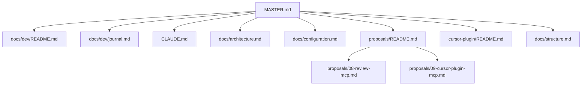

# 🧭 Project Navigator: ai-reviewer

> 📊 Meta: `{"version": "0.3.0", "last_updated": "2026-09-10", "context_depth": "L0", "repo": "/Users/dakh/Git/_my/ai-reviewer"}`

> L0 для агента. Истина по гейту — architecture. Журнал разработки — `docs/dev/journal.md`. RFC — `proposals/`.

## 1. 🎯 Executive Summary

- **Проект:** `ai-reviewer` — движок AI код-ревью для PR с правом блокировать merge. Чистый ESM, Node ≥ 22, ноль runtime-зависимостей. LLM по умолчанию — Ollama Cloud.
- **Текущий статус:** `🟢 ACTIVE` — merge-гейт живой; агентный контур RFC 08/09 в пакете (Unreleased).
- **Ключевые ограничения:**
  - Гейт **не знает** structure.
  - MCP-превью **не гейт**: `previewWouldBlock` ≠ `exit 1`.
  - Два stdio MCP: `pr-review-mcp` и `pr-review-structure-mcp`.
  - Плагин Cursor не содержит бинарь движка.

## 2. 🗺️ Context Map



## 3. 🧩 Modular Sections

### Как вести лог
- **Описание:** куда писать journal / execution-log / CHANGELOG / RFC; sync в cod-doc.
- **Ссылка:** `📁 docs/dev/README.md | 🗃️ doc:docs_dev_README_md | 🔑 sha:33834b8bc50f`
- **Статус:** `🟢 VERIFIED`

### Журнал разработки
- **Описание:** живой лог решений и прогонов; сессионные execution-log рядом.
- **Ссылка:** `📁 docs/dev/journal.md | 🗃️ doc:docs_dev_journal_md | 🔑 sha:e18a952c6cd3`
- **Статус:** `🟢 VERIFIED`

### Сессия 2026-09-10 (RFC 08/09)
- **Описание:** execution-log реализации MCP и Cursor Plugin.
- **Ссылка:** `📁 docs/dev/log/2026-09-10-rfc-08-09-mcp-plugin.md | 🗃️ doc:docs_dev_log_2026-09-10-rfc-08-09-mcp-plugin_md | 🔑 sha:054715c0736e`
- **Статус:** `🟢 VERIFIED`

### Архитектура гейта
- **Описание:** поток router → prescan → MoA → verifier → FP → гейт.
- **Ссылка:** `📁 docs/architecture.md | 🗃️ doc:docs_architecture_md | 🔑 sha:79818f73cce5`
- **Статус:** `🟢 VERIFIED`

### Конфигурация
- **Описание:** env, CLI, sidecar MCP, `REVIEW_MCP_EXTRA`, `uncommitted`.
- **Ссылка:** `📁 docs/configuration.md | 🗃️ doc:docs_configuration_md | 🔑 sha:4ee99eaba033`
- **Статус:** `🟢 VERIFIED`

### RFC 08 — MCP полного прогона
- **Описание:** `review_run` / `review_findings`, pinned dry-run.
- **Ссылка:** `📁 proposals/08-review-mcp.md | 🗃️ doc:proposals_08-review-mcp_md | 🔑 sha:5ff94aaa65b6`
- **Статус:** `🟢 VERIFIED`

### RFC 09 — Cursor Plugin
- **Описание:** дешёвые стадии, sidecar, git-пин, `cursor-plugin/`.
- **Ссылка:** `📁 proposals/09-cursor-plugin-mcp.md | 🗃️ doc:proposals_09-cursor-plugin-mcp_md | 🔑 sha:fa4535a53ec8`
- **Статус:** `🟡 DRAFT`

### Cursor Plugin
- **Описание:** local install, два MCP, skill, rule.
- **Ссылка:** `📁 cursor-plugin/README.md | 🗃️ doc:cursor-plugin_README_md | 🔑 sha:ecbd09c43fa1`
- **Статус:** `🟢 VERIFIED`

### Structure-контур
- **Описание:** facts/assessment; MCP `structure_context`; ничего не блокирует.
- **Ссылка:** `📁 docs/structure.md | 🗃️ doc:docs_structure_md | 🔑 sha:5053444b3ee7`
- **Статус:** `🟢 VERIFIED`

### Индекс RFC
- **Описание:** таблица решений 01–09.
- **Ссылка:** `📁 proposals/README.md | 🗃️ doc:proposals_README_md | 🔑 sha:dcab3bf8c5db`
- **Статус:** `🟢 VERIFIED`

### Changelog
- **Описание:** SemVer-релизы и Unreleased.
- **Ссылка:** `📁 CHANGELOG.md | 🗃️ doc:CHANGELOG_md | 🔑 sha:03e21503e489`
- **Статус:** `🟢 VERIFIED`

### Стандарт агента
- **Описание:** границы модулей, DI, fail-open, процесс RFC и релиза.
- **Ссылка:** `📁 CLAUDE.md | 🗃️ doc:CLAUDE_md | 🔑 sha:a5f357386e6f`
- **Статус:** `🟢 VERIFIED`

## 4. ⚡ Quick Actions & Handoffs

```json
{
  "next_step": "Коммиты RFC 09 по порядку из плана; local plugin → /review-prescan → /review-preview",
  "required_input": "",
  "blocked_by": []
}
```

## 5. ✅ Validation & Changelog

```json
{
  "self_check": {
    "links_verified": true,
    "hashes_match": true,
    "no_hallucinations": true,
    "context_depth": "L0",
    "missing_info": []
  },
  "changelog": [
    {
      "date": "2026-09-10",
      "action": "Фронтматтер, журнал разработки, execution-log RFC 08/09, реестр хэшей",
      "author": "cursor-grok",
      "scope": "master"
    }
  ]
}
```

---

## 📖 Snowball Protocol

| Уровень | Загружено | Когда |
|---------|-----------|-------|
| `L0` | Только `MASTER.md` | Старт сессии |
| `L1` | MASTER + 1 целевой файл | Явный запрос раздела |
| `L2` | L1 + зависимости | Запрос анализа зависимостей |
