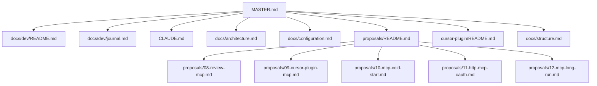

# 🧭 Project Navigator: ai-reviewer

> 📊 Meta: `{"version": "0.3.0", "last_updated": "2026-09-30", "context_depth": "L0", "repo": "/Users/dakh/Git/_my/ai-reviewer"}`

> L0 для агента. Истина по гейту — architecture. Журнал разработки — `docs/dev/journal.md`. RFC — `proposals/`.

## 1. 🎯 Executive Summary

- **Проект:** `ai-reviewer` — движок AI код-ревью для PR с правом блокировать merge. Чистый ESM, Node ≥ 22, ноль runtime-зависимостей. LLM по умолчанию — Ollama Cloud.
- **Текущий статус:** `🟢 ACTIVE` — merge-гейт живой; агентный контур RFC 08/09/10/12 в пакете (Unreleased); ядро частично портировано на Rust с откатом на JS.
- **Ключевые ограничения:**
  - Гейт **не знает** structure.
  - MCP-превью **не гейт**: `previewWouldBlock` ≠ `exit 1`.
  - Два stdio MCP: `pr-review-mcp` и `pr-review-structure-mcp`.
  - Плагин Cursor не содержит бинарь движка.

## 2. 🗺️ Context Map



## 3. 🧩 Modular Sections

### Как вести лог
- **Описание:** куда писать journal / execution-log / CHANGELOG / RFC; sync в cod-doc.
- **Ссылка:** `📁 docs/dev/README.md | 🗃️ doc:docs_dev_README_md | 🔑 sha:4ed5f72ce9ed`
- **Статус:** `🟢 VERIFIED`

### Журнал разработки
- **Описание:** живой лог решений и прогонов; сессионные execution-log рядом.
- **Ссылка:** `📁 docs/dev/journal.md | 🗃️ doc:docs_dev_journal_md | 🔑 sha:2df418793059`
- **Статус:** `🟢 VERIFIED`

### Сессия 2026-09-10 (RFC 08/09)
- **Описание:** execution-log реализации MCP и Cursor Plugin.
- **Ссылка:** `📁 docs/dev/log/2026-09-10-rfc-08-09-mcp-plugin.md | 🗃️ doc:docs_dev_log_2026-09-10-rfc-08-09-mcp-plugin_md | 🔑 sha:b170bd76399b`
- **Статус:** `🟢 VERIFIED`

### Архитектура гейта
- **Описание:** поток router → prescan → MoA → verifier → FP → гейт.
- **Ссылка:** `📁 docs/architecture.md | 🗃️ doc:docs_architecture_md | 🔑 sha:04237a60479b`
- **Статус:** `🟢 VERIFIED`

### Конфигурация
- **Описание:** env, CLI, sidecar MCP, `REVIEW_MCP_EXTRA`, `uncommitted`.
- **Ссылка:** `📁 docs/configuration.md | 🗃️ doc:docs_configuration_md | 🔑 sha:ec6b36a8d2a9`
- **Статус:** `🟢 VERIFIED`

### RFC 08 — MCP полного прогона
- **Описание:** `review_run` / `review_findings`, pinned dry-run.
- **Ссылка:** `📁 proposals/08-review-mcp.md | 🗃️ doc:proposals_08-review-mcp_md | 🔑 sha:5ff94aaa65b6`
- **Статус:** `🟢 VERIFIED`

### RFC 09 — Cursor Plugin
- **Описание:** дешёвые стадии, sidecar, git-пин, `cursor-plugin/`.
- **Ссылка:** `📁 proposals/09-cursor-plugin-mcp.md | 🗃️ doc:proposals_09-cursor-plugin-mcp_md | 🔑 sha:9965d2d623d6`
- **Статус:** `🟢 VERIFIED`

### RFC 10 — Холодный старт MCP
- **Описание:** матрица P/W, `.engine-root`, handshake без пайплайна, не Authenticate.
- **Ссылка:** `📁 proposals/10-mcp-cold-start.md | 🗃️ doc:proposals_10-mcp-cold-start_md | 🔑 sha:17b7ed83442e`
- **Статус:** `🟢 VERIFIED`

### RFC 11 — HTTP MCP и OAuth (черновик)
- **Описание:** третий контур hosted/Cloud Agents; не лечение Authenticate на stdio.
- **Ссылка:** `📁 proposals/11-http-mcp-oauth.md | 🗃️ doc:proposals_11-http-mcp-oauth_md | 🔑 sha:2f4f89c9a793`
- **Статус:** `⚪ DRAFT`

### RFC 12 — Долгий MoA в IDE
- **Описание:** `wait`/`jobId` против таймаута tools/call; spawn без cwd окна; один канал на потребителя.
- **Ссылка:** `📁 proposals/12-mcp-long-run.md | 🗃️ doc:proposals_12-mcp-long-run_md | 🔑 sha:91f4cd250536`
- **Статус:** `🟢 VERIFIED`

### RFC 13 — Судья гейта
- **Описание:** стадия-судья поверх `resolveBlockers`; коридор из двух рельсов; усталость вне цели, путь включения через `shadow`.
- **Ссылка:** `📁 proposals/13-gate-judge.md | 🗃️ doc:proposals_13-gate-judge_md | 🔑 sha:22b84319ff6e`
- **Статус:** `🟢 VERIFIED`

### Cursor Plugin
- **Описание:** local install, два MCP, skill, rule.
- **Ссылка:** `📁 cursor-plugin/README.md | 🗃️ doc:cursor-plugin_README_md | 🔑 sha:2ff130c14ca9`
- **Статус:** `🟢 VERIFIED`

### Structure-контур
- **Описание:** facts/assessment; MCP `structure_context`; ничего не блокирует.
- **Ссылка:** `📁 docs/structure.md | 🗃️ doc:docs_structure_md | 🔑 sha:851a4569ca1c`
- **Статус:** `🟢 VERIFIED`

### Индекс RFC
- **Описание:** таблица решений 01–13.
- **Ссылка:** `📁 proposals/README.md | 🗃️ doc:proposals_README_md | 🔑 sha:538fa4312880`
- **Статус:** `🟢 VERIFIED`

### Changelog
- **Описание:** SemVer-релизы и Unreleased.
- **Ссылка:** `📁 CHANGELOG.md | 🗃️ doc:CHANGELOG_md | 🔑 sha:a975f50f3989`
- **Статус:** `🟢 VERIFIED`

### README
- **Описание:** точка входа потребителя: установка, CLI, подключение к CI.
- **Ссылка:** `📁 README.md | 🗃️ doc:README_md | 🔑 sha:8a2c17944ec9`
- **Статус:** `🟢 VERIFIED`

### Индекс документации
- **Описание:** все документы `docs/` и соседние README; сюда — всё, чего нет в этом реестре.
- **Ссылка:** `📁 docs/README.md | 🗃️ doc:docs_README_md | 🔑 sha:e62555178e57`
- **Статус:** `🟢 VERIFIED`

### Бэклог
- **Описание:** открытые направления и долг слияний вне планов cod-doc.
- **Ссылка:** `📁 docs/backlog.md | 🗃️ doc:docs_backlog_md | 🔑 sha:cd61791fe667`
- **Статус:** `🟢 VERIFIED`

### Стандарт агента
- **Описание:** границы модулей, DI, fail-open, процесс RFC и релиза.
- **Ссылка:** `📁 CLAUDE.md | 🗃️ doc:CLAUDE_md | 🔑 sha:f6c410eaae6c`
- **Статус:** `🟢 VERIFIED`

## 4. ⚡ Quick Actions & Handoffs

```json
{
  "next_step": "gate-judge: GATE-002 (fix blockerClusters), затем секция B (история в футере); MCP-011",
  "required_input": "",
  "blocked_by": []
}
```

## 5. ✅ Validation & Changelog

```json
{
  "self_check": {
    "links_verified": true,
    "hashes_match": true,
    "no_hallucinations": true,
    "context_depth": "L0",
    "missing_info": []
  },
  "changelog": [
    {
      "date": "2026-09-30",
      "action": "RFC 13 принят (В1–В3), задачи gate-judge обновлены",
      "author": "claude",
      "scope": "master"
    },
    {
      "date": "2026-09-29",
      "action": "RFC 13 (черновик) по сверке плана gate-judge с кодом",
      "author": "claude",
      "scope": "master"
    },
    {
      "date": "2026-09-29",
      "action": "Аудит документации: статусы RFC 07/09/10/12 → active, next_step, реестр канона",
      "author": "claude",
      "scope": "master"
    },
    {
      "date": "2026-09-12",
      "action": "RFC 12 (черновик) и план mcp-ide-resilience в реестре",
      "author": "cursor-grok",
      "scope": "master"
    },
    {
      "date": "2026-09-10",
      "action": "Фронтматтер, журнал разработки, execution-log RFC 08/09, реестр хэшей",
      "author": "cursor-grok",
      "scope": "master"
    }
  ]
}
```

---

## 📖 Snowball Protocol

| Уровень | Загружено | Когда |
|---------|-----------|-------|
| `L0` | Только `MASTER.md` | Старт сессии |
| `L1` | MASTER + 1 целевой файл | Явный запрос раздела |
| `L2` | L1 + зависимости | Запрос анализа зависимостей |
