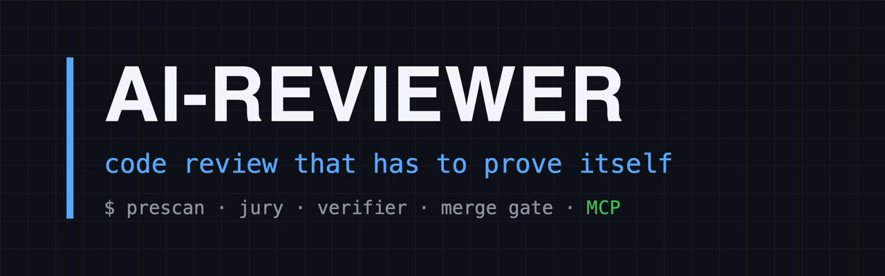
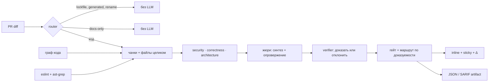

<div align="center">



[](https://github.com/Orange-hanter/ai-reviewer/actions/workflows/ci.yml)
[](CHANGELOG.md)
[](package.json)
[](package.json)
[](#лицензия)

**AI-ревью, которое шумит, хуже отсутствия ревью.<br>
ai-reviewer делает находку <i>доказуемой</i> — и даёт человеку и LLM-агенту один общий, аудируемый контур правды о коде.**

[Архитектура](docs/architecture.md) · [Структура и сценарии](docs/structure.md) · [Профиль проекта](docs/profiles.md) · [Интеграция](docs/integration.md) · [Конфигурация](docs/configuration.md)

</div>

---

Дифф → blast-radius по графу кода → детерминированный prescan → жюри из трёх специалистов →
verifier → inline-замечания и один живой sticky-отчёт в PR. Merge блокируется **только на
подтверждённых** `critical`/`major`: находка обязана пережить опровержение жюри и второй
проход независимой модели. Инфра-сбои merge не блокируют.

## Возможности

- **Двое независимых судей на каждую находку.** Жюри опровергает претензии специалистов,
  verifier доказывает кандидата по коду. Нет вердикта — находка понижается, а не блокирует.
- **Детерминированный prescan.** eslint и ast-grep проходят первыми: их находки идут в гейт
  и в промпт как «уже сказано» — LLM не тратит бюджет на то, что считается точно.
- **Blast-radius по графу кода.** Ревьюер видит, кто зависит от изменённых символов
  **вне диффа**, а не только сами правки.
- **Маршрут по доказуемости, а не по ярлыку.** prescan, вердикт verifier'а, повторяемость,
  консенсус, чувствительная зона — severity от модели само по себе ничего не решает.
- **Память между прогонами.** Sticky несёт машинный футер с отпечатками кода и историей:
  починенное снимается, перенесённое не переоткрывается новыми словами, Δ-блок показывает
  разницу прогонов.
- **Петля обучения на FP.** 👎 или метка → журнал → промоут в FP-паттерн **и** eval-fixture,
  который держит регрессию. Ошибка не повторяется из PR в PR.
- **Ноль зависимостей.** Node ≥ 22 и всё: `npm install` не нужен, движок пинится по тегу
  или SHA и никогда не исполняется из кода PR.
- **Всё специфичное — в профиле.** Маркеры, правила проекта, раскладка каталогов, пути
  данных — один JSON на стороне потребителя; без профиля движок не выдумывает архитектуру.

## Что видит разработчик

Один sticky-комментарий на PR, который переписывается на каждом прогоне (реальный вывод движка):

> ## 🤖 Авто код-ревью — 🔴 нужны правки
>
> ⛔ **Merge заблокирован:** 2 замечания. Правило блокировки: critical/major — от MoA-aggregator; confidence ≥0.8.
>
> ### Оценки моделей
> - **moa-specialist(minimax-m3←security+correctness+architecture)** — 3 (🔴1 🟠1 🟡1 🔵0): две проблемы уровня блока: IDOR и потеря копеек.
>   - specialist **security/deepseek-v4-flash** — ok
>   - specialist **correctness/kimi-k2.7-code** — ok
>   - specialist **architecture/glm-5.2** — ok
>
> **Итого:** 3 замечания. Файлов в диффе: 3.
>
> 🔄 **С прошлого прогона (`4b1e07c`):** +1 новых, −1 закрыто, 1 без изменений.
> Раскрывается в «что изменилось» и таблицу истории прогонов.
>
> 🔎 Verifier (Pass B, deepseek-v4-pro): подтверждено 2, отклонено FP 1, понижено 1.
>
> ⚖️ Refutation (жюри): dropped 2, downgraded 1, kept 3.
>
> 🔧 Prescan (eslint + ast-grep): 1 детерминированная находка на 3 файлах.

Плюс inline-треды на самих строках — но только для находок, доказуемость которых движок может
обосновать; остальное сворачивается в сводку, чтобы PR оставался читаемым.

<details>
<summary>Что лежит в скрытом футере sticky</summary>

Каждый sticky несёт машинный блок `<!-- ai-review-data:{…} -->` со списком находок,
отпечатками кода под ними и историей последних прогонов. Из него следующий прогон узнаёт,
что уже было сказано: код под находкой изменился — снимаем, остался прежним — переносим и не
переоткрываем тему новыми словами. Оттуда же берут данные Δ-блок и harvest 👍/👎.

</details>

## Почему не «ещё один AI-ревьюер»

| Типовая боль | Что сделано |
|---|---|
| Модель уверенно выдумывает дефект | Блок требует **двух независимых судей**: жюри опровергает претензии специалистов, verifier доказывает кандидата по коду. Нет вердикта → находка понижается |
| «В PR нет теста/файла X», а он в диффе | Полный список изменённых файлов и e2e-спек **в каждом чанке**, с метками частей и прямым запретом заявлять отсутствие невидимого |
| Прогоны не сходятся: находок всё больше | Sticky несёт машинный футер с отпечатками кода и историей; повтор снимается, если код починен, а Δ-блок показывает разницу прогонов |
| Ревью тонет в стилистических придирках | eslint и ast-grep проходят первыми: их находки идут в гейт и в промпт как «уже сказано» |
| Замечания «где-то рядом» без последствий | Маршрут находки считается по **доказуемости** (prescan, verifier, повтор, консенсус, чувствительная зона), а не по ярлыку severity от модели |
| Ошибки повторяются из PR в PR | 👎 или метка → журнал → промоут в FP-паттерн **и** eval fixture, который держит регрессию |
| Ревьюер видит файл, но не его последствия | blast-radius по графу кода: кто зависит от изменённых символов вне диффа |

## Как устроен прогон



Подробно — [docs/architecture.md](docs/architecture.md).

## За пределами PR: анализ всей кодовой базы

Второй контур движка — `pr-review-structure`: вне-PR анализ, который **не трогает
merge-гейт**, но строит доказуемую картину всего репозитория. Из независимых провайдеров —
граф кода (Graphify), точные символы и ссылки (SCIP), покрытие (LCOV), мутационные и
property-отчёты — собираются версионируемые артефакты:

- **structure-facts** — границы, сущности, контракты, зависимости, инвентарь тестов;
- **structure-assessment** — статусы сценариев (`covered` / `partial` / `missing` /
  `unverifiable`) только на доказательствах: агрегатное покрытие файла не доказывает
  error/boundary-сценарий;
- **structure-drift** — расхождение снимков между коммитами;
- **receipts** — неизменяемый отпечаток происхождения каждого куска evidence.

Приоритет evidence детерминирован: SCIP/compiler exact → Graphify EXTRACTED →
INFERRED → AMBIGUOUS. Провайдеры никогда не выносят вердикт — статусы считает
детерминированный движок оценки.

## Симбиоз с агентами

Ревьюер и кодящие агенты питаются одним и тем же снимком структуры — через
MCP-сервер `pr-review-structure-mcp` и его метод `structure_context`:

- агент запрашивает контекст **по пину** (`headSha` или `snapshotFingerprint` снимка
  facts) — никакого неявного «latest»: планирование и правки идут на том же состоянии
  кода, что видело ревью;
- ответ — ограниченный бюджетом токенов BFS-срез: релевантные контракты, зависимости,
  сценарии, подсказки и файлы, а не простыня всего графа;
- обратная связь замыкается: 👎 на находке становится FP-паттерном и eval-fixture,
  а подтверждённые пробелы в evidence — задачами для агента.

```json
{ "mcpServers": { "ai-reviewer-structure": { "command": "npx", "args": ["pr-review-structure-mcp"] } } }
```

Статусы, приоритеты evidence, cod-doc-интеграция — [docs/structure.md](docs/structure.md).

## Быстрый старт

```bash
git clone git@github.com:Orange-hanter/ai-reviewer.git
cd ai-reviewer
npm test && npm run eval          # зависимостей нет, npm install не нужен
```

Ревью произвольного диффа, без GitHub:

```bash
git -C /path/to/repo diff origin/main... > /tmp/changes.patch
OLLAMA_API_KEY=… npx pr-review --dry-run --diff /tmp/changes.patch
```

Ревью настоящего PR:

```bash
GITHUB_TOKEN=… GITHUB_REPOSITORY=owner/repo PR_NUMBER=123 OLLAMA_API_KEY=… \
  REVIEW_PROFILE=ops/ai-review/profile.json npx pr-review
```

Структура, контракты, dependencies и тестовые evidence вне merge-гейта:

```bash
npx pr-review-structure \
  --graph .graphify/graphify-out/graph.json \
  --lcov coverage/lcov.info \
  --facts-out .ai-review/structure/structure-facts.json \
  --assessment-out .ai-review/structure/structure-assessment.json
```

## CLI

| Команда | Назначение |
|---------|------------|
| `pr-review` | Полный прогон (PR или `--diff`) |
| `pr-review-eval` | Golden fixtures без LLM — гейт post-processing |
| `pr-review-gold` | Shadow-прогон с LLM на размеченных TP/FP диффах |
| `pr-review-metrics` | Сводка по логам прогонов |
| `pr-review-probe-models` | Доступность, latency и JSON-mode моделей |
| `pr-review-feedback` · `-batch` | Сбор 👍/👎 с PR |
| `pr-review-structure` | Structure facts/assessment, drift, property drafts и Markdown |
| `pr-review-structure-mcp` | Pinned-SHA `structure_context` MCP для агентов |

## Профиль проекта

Всё, что отличает один репозиторий от другого, — в одном файле:

```jsonc
{
  "name": "acme",
  "markerNamespace": "acme-review",          // маркеры своих комментариев
  "repoRulesFile": "repo-rules.md",          // слои и примитивы проекта → в промпт
  "layout": {
    "appDir": "app",                         // где лежит код и node_modules линтеров
    "layerDirs": ["server", "shared", "client"],
    "lintable": "^app/(?:server|shared|client)/.+\\.(?:ts|tsx)$"
  },
  "astgrep": { "allow": { "raw-x-forwarded-for": ["app/server/net.ts"] } },
  "paths": { "feedbackLog": "ops/ai-review/feedback/fp-feedback.jsonl" }
}
```

Без профиля движок работает на нейтральных дефолтах и не выдумывает архитектуру, которой не
знает. Полная схема — [docs/profiles.md](docs/profiles.md).

## Подключение к CI

Движок берётся по пину и **никогда не исполняется из кода PR** — иначе вредоносный PR получил
бы секреты прогона:

```
ops/ai-reviewer-ref          # v0.2.0 или commit SHA — пин читается из базовой ветки
ops/ai-review/profile.json   # профиль проекта
```

Готовые шаблоны workflow (ревью, сбор feedback, промоут паттернов, метрики) —
[`examples/ci/`](examples/ci/), пошагово — [docs/integration.md](docs/integration.md).

## Документация

| Раздел | О чём |
|--------|-------|
| [architecture.md](docs/architecture.md) | Поток данных, модули, ключевые решения |
| [profiles.md](docs/profiles.md) | Профиль проекта: все поля и зачем каждое |
| [configuration.md](docs/configuration.md) | CLI и все env-переменные с дефолтами |
| [integration.md](docs/integration.md) | Подключение потребителя, пин, требования |
| [structure.md](docs/structure.md) | Вне-PR анализ кодовой базы, MCP-контекст для агентов |
| [false-positives.md](docs/false-positives.md) | Семейства FP, встроенные защиты, петля обучения |
| [model-tuning.md](docs/model-tuning.md) | Роли моделей, температуры, чанки, reasoning effort |

## Разработка

```bash
npm test        # юнит + контракты (в т.ч. шаблоны workflow)
npm run eval    # golden fixtures без LLM
npm run check   # то и другое
```

Регрессионный набор гоняется под reference-профилем [`profiles/orakul.json`](profiles/orakul.json) —
тем же, на котором движок работал внутри первого потребителя до выноса в отдельный пакет: это и
есть доказательство, что вынос ничего не поменял. Нейтральный профиль покрыт отдельно
(`test/profile.test.mjs`).

Провайдер LLM — Ollama Cloud; смена моделей проверяется `pr-review-probe-models` → `npm run eval`
→ `pr-review-gold`.

## Лицензия

Private / UNLICENSED — внутренний инструмент Orange-hanter / Mozarella.
