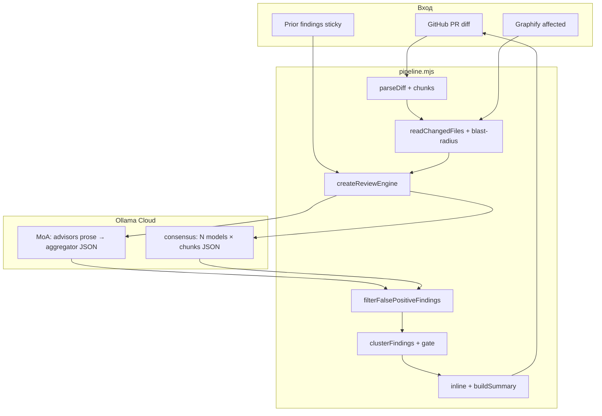

# Архитектура AI Code Review Pipeline

Автоматическое код-ревью pull request'ов: unified diff → Graphify blast-radius → LLM (Ollama Cloud) → inline + sticky-комментарии в GitHub.

Merge **блокируется** exit-кодом `1` только при подтверждённых блокерах (`critical` / `major`). Инфра-сбои (модель, GitHub, граф) — **мягкий** exit `0`.

## Поток данных

## Модули

| Модуль | Назначение |
|--------|------------|
| `bin/pr-review.mjs` | CLI entry |
| `pipeline.mjs` | `createReviewPipeline()`, `runReview()` |
| `lib/config.mjs` | `loadReviewConfig()` — env + CLI |
| `lib/diff.mjs` | Парсинг diff, чанкинг, full-file context |
| `lib/graphify.mjs` | `gf affected` → blast-radius |
| `lib/engine.mjs` | MoA + consensus, fallback моделей |
| `lib/ollama.mjs` | SSE chat, JSON-mode, retries |
| `lib/prompt.mjs` | Промпты aggregator / MoA advisors |
| `lib/findings.mjs` | FP-filter, cluster, classify inline |
| `lib/verifier.mjs` | Pass B для critical/major (R3) |
| `lib/router.mjs` | skip/light/full по типу diff (R4) |
| `lib/specialists.mjs` | Role advisors + refutation (R5) |
| `lib/prescan.mjs` / `lib/astgrep.mjs` | eslint + ast-grep prescan (R6) |
| `lib/triage.mjs` | Auto-resolve known FP threads (R11) |
| `lib/feedback.mjs` | GitHub harvest loop (R8) |
| `lib/export.mjs` | JSON + SARIF (R9) |
| `lib/observability.mjs` | JSONL run log (R7) |
| `lib/eval.mjs` | Golden fixtures без LLM (R1) |

## Режимы LLM

### MoA (default)

1. **Specialist advisors** (security / correctness / architecture) — prose, `stream: true`
2. **Aggregator** (`minimax-m2.7`) — JSON findings
3. **Verifier** (`deepseek-v4-pro`) — Pass B для critical/major

Aggregator и verifier **не** входят в pool specialists.

### Consensus

`REVIEW_MODE=consensus` — каждая модель × каждый чанк; `REVIEW_CONSENSUS=N` для кластера-блокера.

## Roadmap (as-built)

| ID | Статус | Описание |
|----|--------|----------|
| R1 | ✅ | Eval harness + golden fixtures |
| R2 | ✅ | Confidence gate (`REVIEW_CONFIDENCE_MIN`) |
| R3 | ✅ | Verifier pass |
| R4 | ✅ | Change router |
| R5 | ✅ | Specialists + refutation |
| R6 | ✅ | eslint prescan |
| R6+ | ✅ | ast-grep prescan (7 rules) |
| R7 | ✅ | Observability JSONL |
| R8 | ✅ | GitHub feedback harvest |
| R9 | ✅ | SARIF export |
| R10 | 📋 | Multi-provider (planned) |
| R11 | ✅ | Auto-triage threads |

## Цели и границы

| В scope | Вне scope |
|---------|-----------|
| Логика, RBAC, слои, blast-radius регрессии | Стиль/formatting (eslint/tsc) |
| MoA/consensus для снижения FP | Замена human review |
| Стабильный gate на fixtures | Универсальный preset для любого стека без настройки |

## Операционный playbook

1. **Ложный блокер на PR** → 👎 на inline или label `ai-review-fp`
2. **Harvest** → `pr-review-feedback` / daily batch workflow
3. **Promote** (≥2 одинаковых FP) → `fp-patterns.jsonl` + eval fixture
4. **Eval green** → `npm run eval` перед merge изменений движка

Подробнее: [feedback/README.md](../feedback/README.md), [fixtures/README.md](../fixtures/README.md), [ai-review-false-positives.md](ai-review-false-positives.md).

## История

Изначально разработано для [Orakul](https://github.com/Orange-hanter/Orakul) (`ops/pr-review/`). С 2026-07-12 — standalone пакет `@orakul/ai-reviewer`.
