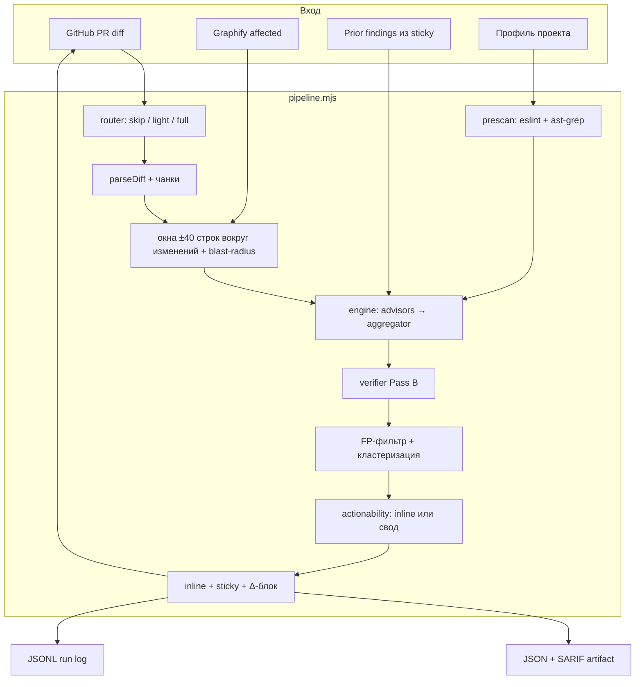

# Архитектура

Автоматическое ревью pull request'а: unified diff → blast-radius по графу кода →
детерминированный prescan → LLM (Mixture-of-Agents) → inline + sticky в GitHub.

Merge блокируется exit-кодом `1` только на **подтверждённых** блокерах (`critical`/`major`).
Инфра-сбои (модель, GitHub, граф) — мягкий exit `0`; исключение — полный аутедж LLM при
`REVIEW_LLM_REQUIRED=1`: без ревью гейт не может подтвердить PR.

## Поток данных

## Модули

| Модуль | Назначение |
|--------|------------|
| `bin/pr-review.mjs` | CLI полного прогона (JS; у потребителя — `pr-review review`, удаляется в T33) |
| `pipeline.mjs` | `createReviewPipeline()`, `run()` / `runDetailed()`, `runReview()` — оркестрация |
| `lib/profile.mjs` | [Профиль проекта](profiles.md): маркеры, правила, раскладка, пути |
| `lib/config.mjs` | `loadReviewConfig()` — профиль + env + CLI в один замороженный объект |
| `lib/router.mjs` | Классификация путей диффа и маршрут skip / light / full |
| `lib/diff.mjs` | Парсинг diff, чанкинг, аннотация номеров строк |
| `lib/context-window.mjs` | Окна контекста ±`REVIEW_CONTEXT_MARGIN` вокруг изменённых строк (advisors, жюри) и строк-кандидатов (verifier); короткий файл — целиком ([RFC 07](../proposals/07-windowed-file-context.md)) |
| `lib/incremental.mjs` | Инкрементальный прогон: перенос находок файлов с неизменным входом модели (`REVIEW_INCREMENTAL`, [RFC 05](../proposals/05-incremental-review.md)) |
| `lib/graphify.mjs` | `graphify affected` → blast-radius изменённых символов |
| `lib/blast-findings.mjs` | Детерминированные major по cross-layer/community callers (soft: блок merge только после verifier) |
| `lib/prescan.mjs`, `lib/astgrep.mjs`, `lib/prescan-shared.mjs` | eslint + ast-grep по изменённым файлам |
| `lib/engine.mjs` | MoA и consensus, fallback моделей, дедлайн прогона |
| `lib/chunk-routing.mjs` | Чанк без исполняемого файла → один агрегатор без жюри ([RFC 04](../proposals/04-token-economy.md)) |
| `lib/specialist-merge.mjs` | Роли на одной модели — одним вызовом и разбор ответа обратно по ролям (RFC 04) |
| `lib/llm.mjs` | OpenAI-compatible чат: SSE, JSON-mode, ретраи, адаптивный семафор по 429 (`lib/ollama.mjs` — deprecated re-export) |
| `lib/cost.mjs` | Учёт токенов и оценка стоимости прогона (`REVIEW_PRICE_JSON`) |
| `lib/prompt.mjs` | Системные промпты: aggregator, advisors, verifier |
| `lib/prompt-layout.mjs` | Раскладка сообщений под префиксный кэш: общая рамка и контекст чанка до инструкции роли (RFC 04) |
| `lib/specialists.mjs` | Роли advisors + refutation жюри |
| `lib/verifier.mjs` | Pass B: доказать / отклонить / понизить кандидатов в блокеры |
| `lib/findings.mjs` | Нормализация, FP-фильтр, кластеризация, гейт |
| `lib/actionability.mjs` | Маршрут находки по доказуемости, а не по ярлыку severity |
| `lib/report.mjs` | Sticky, Δ-блок, машинный футер, свод advisory |
| `lib/triage.mjs` | Авто-ответ и resolve на своих тредах с известным FP |
| `lib/github.mjs` | GitHub API: sticky, inline-треды, реакции |
| `lib/feedback.mjs`, `feedback/*` | Сбор 👍/👎 → JSONL → паттерны и fixtures |
| `lib/export.mjs` | JSON + SARIF артефакт прогона (+ sidecar swarm) |
| `lib/swarm.mjs` | E22/E23: `strong` verdict + `suggestedScopeFiles` для оркестратора |
| `lib/structure*.mjs` | Off-PR structure facts/assessment: Graphify + SCIP + LCOV + scenario evidence |
| `bin/pr-review-structure.mjs` | CLI structure facts, assessments, drift и cod-doc Markdown projection |
| `bin/pr-review-structure-mcp.mjs` | Pinned-SHA `structure_context` для агентов |
| `bin/pr-review-mcp.mjs` | Агентный dry-run ревью (`review_run` / дешёвые стадии); не гейт |
| `lib/mcp-stdio.mjs` | Общий Content-Length транспорт обоих MCP |
| `lib/review-mcp.mjs` | Тулзы ревью-MCP: пин, confinement, slim preview, sidecar |
| `cursor-plugin/` | Cursor Plugin: команды, skill, rule; оба MCP. Не гейт |
| `lib/observability.mjs`, `lib/metrics.mjs` | JSONL-лог прогонов и сводка по нему |
| `lib/eval.mjs` | Golden fixtures без LLM |
| `rust/` | Единый бинарь `pr-review` (подкоманды — ниже) и Rust-порт `lib/*.mjs`: обёртка зовёт бинарь из `rust/target/debug/`, при отсутствии бинаря — JS (см. ниже) |
| `examples/ci/` | Шаблоны workflow потребителя и `fetch-pr-review.sh` — скачивание и сверка бинаря по пину |

**Rust-слой.** Модули `diff`, `router`, `findings`, `engine`, `llm`, `prompt`, `specialists`,
`verifier`, `report`, `github`, `export`, `actionability`, `metrics`, `config`/`profile`,
`json` и `structure-*` — тонкие JS-обёртки над бинарями в `rust/target/debug/` (JSON на stdin).
Бинаря нет — работает эталонный JS; `AI_REVIEWER_<MOD>_BIN` переопределяет путь,
`AI_REVIEWER_<MOD>_FORCE_JS=1` включает чистый JS. Расхождение сторон ловят скрипты
`rust/parity/*.parity.mjs` (`npm run check:parity`). Оркестрация (`pipeline.mjs`,
`chunk-routing`, `specialist-merge`, `incremental`) остаётся в JS.

**Единый бинарь `pr-review` и поставка потребителю** ([RFC 16](../proposals/16-standalone-rust-binary.md)).
Порт свёл движок в один Rust-бинарь с десятью подкомандами (`review`, `eval`, `metrics`,
`structure`, `structure-mcp`, `review-mcp`, `feedback`, `feedback-batch`, `feedback-migrate`,
`feedback-promote`). Потребитель получает его prebuilt-архивом из релиза по пину
`<tag> sha256:<хэш SHA256SUMS>`, читаемому из базовой ветки; цепочка пин → `SHA256SUMS` →
архив сверяется до распаковки ([integration.md](integration.md)). Политики разведены:
недоступность поставки — fail-open (ревью пропускается), несовпадение хэша — fail-closed
(подмена артефакта не должна молча выключать гейт); внутри ревью действует прежний fail-open
движка. JS-ядро (`pipeline.mjs`, `lib/*.mjs`, потребительские `bin/*.mjs`) пока живо и
работает в разработке и как откат MCP-лаунчеров; его удаление — cutover T33, после
реального прогона релизной сборки (T32).

## Ключевые решения

### Маршрут находки — по доказуемости

Раньше маршрут задавала severity, то есть ярлык модели: одна и та же тема на трёх прогонах
одного sha получала critical, major и minor. Теперь **блокировка** осталась по severity, а
**где показывать** считается по детерминированным сигналам, которые пайплайн уже имеет:
подтверждение prescan'ом на той же строке, вердикт verifier'а, повтор с прошлого прогона,
независимый консенсус моделей, чувствительная зона файла, наличие конкретного фикса.
Порог — `REVIEW_ACTIONABILITY_MIN`, веса — в [`lib/actionability.mjs`](../lib/actionability.mjs).

### Blast-radius по графу кода

Символы для Graphify берутся не только из hunk-строк: если в диффе правят тело функции
без строки `export`, [`collectBlastSymbols`](../lib/diff.mjs) добирает экспорты из полного
текста затронутых файлов. Отсутствующий `graph.json` — мягкий skip (`graph_missing`), без
вызова `affected`. После `affected` движок обогащает deps из того же `graph.json`: имя
caller, confidence ребра, community (маркер `cross-community`). LLM и verifier обязаны
опираться на перечисленных callers и не выдумывать зависимости вне секции Blast-radius.

### Сходимость между прогонами

Sticky несёт скрытый машинный футер `<ns>-data:` с находками, отпечатками кода и историей
прогонов. Следующий прогон читает его и: показывает Δ (что появилось/ушло), не переоткрывает
уже закрытые темы, не переформулирует их заново. Отпечаток — это код, на который показывает
находка: код изменился → находка снимается, код на месте → переносится.

Стабильность набора меряется Jaccard по **точкам кода** (не по формулировкам): модели
перефразируют один дефект, а место в коде воспроизводимо. Воспроизводимость **вердикта**
(блокировал / нет) считается отдельно по прогонам одного sha.

Маркер комментария — часть профиля. **Смена namespace на живом репозитории рвёт эту цепочку**:
прошлые sticky/inline перестают быть «своими».

### Два независимых судьи перед блоком

Aggregator собирает находки из advisors и обязан к каждой приложить refutation по ролям.
Verifier (отдельная модель, вне пула advisors) доказывает или отклоняет кандидатов в блокеры.
При `REVIEW_VERIFIER_STRICT=1` отсутствие вердикта понижает находку до minor — блок требует
подтверждения второй моделью.

### Prescan раньше LLM

eslint и ast-grep дают детерминированные находки на изменённых файлах: они и блокируют
по своим правилам, и уходят в промпт как «уже сказано, не повторяй». Scope ast-grep правил
и исключения — из профиля: правило «client не импортирует server» осмысленно только там, где
такие слои есть.

## Режимы LLM

**MoA (по умолчанию).** Specialist advisors (security / correctness / architecture) пишут
prose-разбор → жюри-агрегатор синтезирует JSON-находки с refutation по каждой претензии →
verifier проверяет кандидатов в блокеры. Агрегатор и verifier не входят в пул advisors.

**Consensus.** `REVIEW_MODE=consensus`: каждая модель проходит каждый чанк, блокером
становится кластер, набравший `REVIEW_CONSENSUS` независимых подтверждений.

### Structure — отдельный доказательный контур

[`docs/structure.md`](structure.md) описывает анализ структуры, контрактов и тестовых
сценариев. Он не участвует в merge-гейте. Graphify даёт topology, SCIP уточняет semantic
symbols/ranges, LCOV фиксирует execution, mutation/property providers — качество сценариев.
Провайдеры отдают receipts; статусы `covered|partial|missing|unverifiable` считает только
детерминированный assessment engine. Контекст для планирования всегда привязан к SHA или
fingerprint snapshot.

### Cursor Plugin — не гейт

Каталог [`cursor-plugin/`](../cursor-plugin/) подключает оба stdio MCP в IDE (slash-команды,
skill, rule). Находки в чате advisory; `previewWouldBlock` не блокирует merge. Merge-гейт —
только CI `pr-review` (`exit 1`).

## Границы

| В scope | Вне scope |
|---------|-----------|
| Логика, безопасность, границы слоёв, blast-radius регрессии | Стиль и форматирование (это работа eslint/tsc) |
| Снижение FP: refutation, verifier, паттерны, actionability | Замена human review |
| Воспроизводимый гейт на fixtures | Готовый пресет под любой стек без профиля |

## Проверки самого движка

| Что | Команда |
|-----|---------|
| Юнит + контракты (в т.ч. шаблоны `examples/ci/` — `test/ci-templates.test.mjs`) | `npm test` |
| Golden fixtures без LLM (16 кейсов) | `npm run eval` |
| Rust: `cargo build` + `cargo test` + паритет JS ↔ Rust | `npm run check:rust` (паритет отдельно — `npm run check:parity`) |
| Всё выше, как в CI | `npm run check` |
| Shadow-прогон с LLM на размеченных диффах | `OLLAMA_API_KEY=… npx pr-review-gold` |

Регрессионный набор гоняется под reference-профилем `profiles/orakul.json` — тем же, на
котором движок работал до выноса в отдельный пакет.
